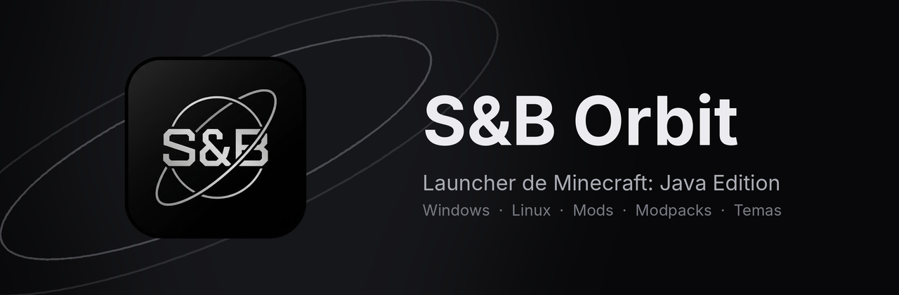
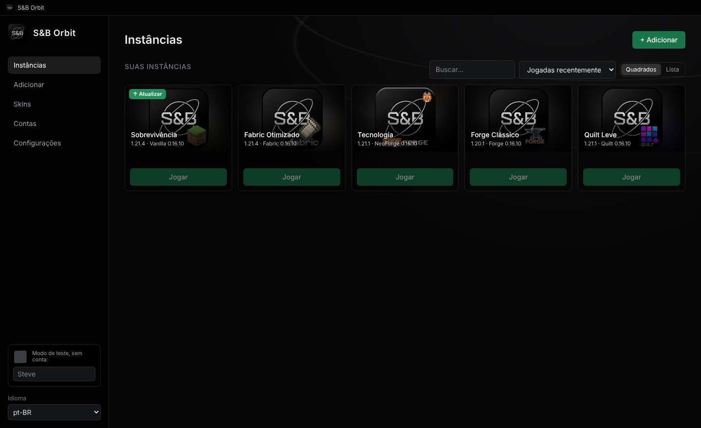
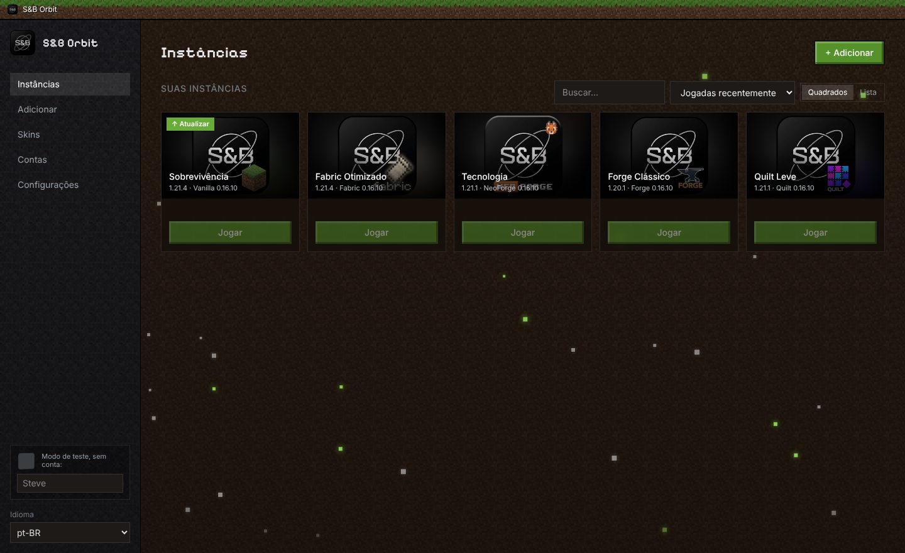
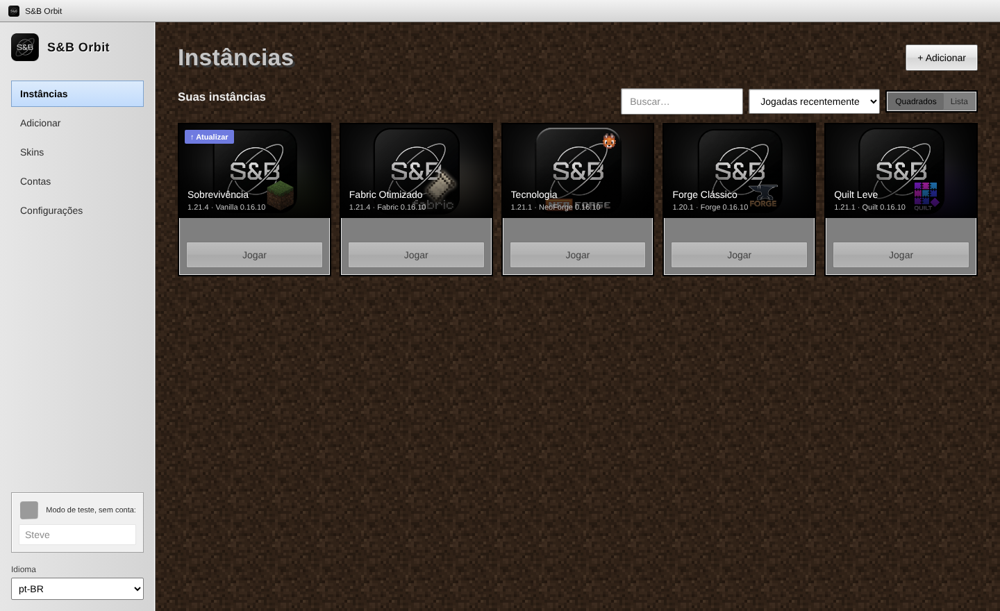
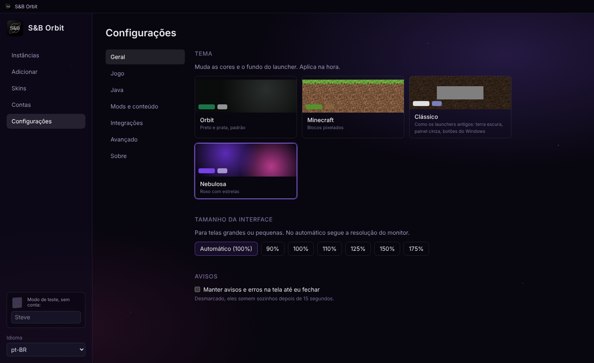

<p align="center">
  
</p>

<p align="center">
  <a href="https://github.com/BSchastai/S-B-Orbit/releases/latest"></a>
  <a href="https://github.com/BSchastai/S-B-Orbit/releases"></a>
  
</p>

<p align="center">
  <b>Um launcher de Minecraft: Java Edition rápido, bonito e sem complicação.</b><br>
  Instâncias separadas, mods e modpacks do Modrinth e do CurseForge, skins, temas animados e atualização automática. Em português, inglês, espanhol, francês e alemão.
</p>

<p align="center">
  <a href="https://github.com/BSchastai/S-B-Orbit/releases/latest"><b>Baixar a versão mais nova</b></a>
  &nbsp;·&nbsp; <a href="#english">English</a>
</p>

<p align="center">
  
</p>

## Qual arquivo baixar?

Na página da [última versão](https://github.com/BSchastai/S-B-Orbit/releases/latest), em **Assets**:

| Sistema | Arquivo | |
|---|---|---|
| **Windows** | `SB.Orbit_x.y.z_x64-setup.exe` | **Recomendado.** Instalador; atualiza sozinho. |
| Windows (sem instalar) | `SB-Orbit-x.y.z-portable-x64.zip` | Descompacte e abra o `SB Orbit.exe`. Também se atualiza. |
| **Linux** (qualquer distro, inclusive **Arch**) | `SB.Orbit_x.y.z_amd64.AppImage` | Dê permissão de execução e abra. |
| Ubuntu, Mint, Debian, Pop!_OS | `SB.Orbit_x.y.z_amd64.deb` | Abra com o instalador de programas. |
| Fedora, openSUSE | `SB.Orbit-x.y.z-1.x86_64.rpm` | Abra com o instalador de programas. |

> Os arquivos `.sig` e o `latest.json` são usados pela atualização automática (assinaturas de segurança). Não precisa baixar.

> **Windows: "O Windows protegeu o computador"?** Aparece em programas novos sem certificado pago. Clique em **Mais informações → Executar assim mesmo**.

<details>
<summary><b>Linux: como abrir o AppImage</b></summary>

```bash
chmod +x SB.Orbit_*_amd64.AppImage
./SB.Orbit_*_amd64.AppImage
```
Se pedir FUSE: `sudo apt install libfuse2` (Ubuntu) ou `sudo pacman -S fuse2` (Arch).
</details>

## O que ele faz

- **Conta Microsoft oficial**: login seguro no site da Microsoft; várias contas e skins (com prévia em 3D).
- **Instâncias separadas**: cada uma com sua versão, mods, mundos e configurações. Vanilla, **Fabric**, **Forge**, **NeoForge** e **Quilt**.
- **Mods e modpacks** do **Modrinth** e do **CurseForge**: busca com filtro por versão e loader, galeria, descrição traduzida, atualização com um clique (ou automática) e aviso de conflitos e de dependências na versão errada.
- **Pronto para jogar**: pacotes iniciais (Otimizado, Bonito com shaders e **Ver longe** com Voxy/Distant Horizons), otimização da JVM explicada e Java baixado sozinho.
- **Cuida dos seus mundos**: backups manuais e automáticos (ao fechar o jogo, por dia ou por semana, e antes de atualizar).
- **Servidores**: lista com status ao vivo e entrar direto pelo launcher.
- **Ajustes do jogo** dentro do launcher: FOV, gráficos, sons, shaders e configurações de mods.
- **Diagnóstico de crash** em português, com a causa provável e o que fazer.
- **Desempenho**: placa de vídeo dedicada em notebooks, prioridade do jogo, limite de downloads, modo leve e **Limpar espaço** (versões sem uso, cache e logs antigos).
- **Discord**: mostra "Jogando" com a instância e o tempo.
- **Temas**: Orbit e Nebulosa (com fundo animado opcional), Minecraft (blocos do seu próprio jogo, biomas, neve, chuva, caverna com minérios e modo automático pelo clima) e Clássico (estilo launcher antigo).
- **Do jeito que você usa**: abrir com o sistema, ícone perto do relógio, avisos do sistema e exportar/importar as configurações.
- **Clientes experimentais** (opcional): Pomme e Horizon, reescritas do Minecraft em Rust feitas por outros projetos.
- **Atualização automática** do próprio launcher, com assinatura verificada.

## Temas

| Minecraft | Clássico |
|---|---|
|  |  |

<p align="center"></p>

## Perguntas rápidas

<details>
<summary><b>Precisa ter o Minecraft original?</b></summary>
Sim. O login é com a sua conta Microsoft que tem o jogo. O launcher não tem e não terá modo pirata.
</details>

<details>
<summary><b>Meus dados ficam onde?</b></summary>
No seu computador. Não existe servidor do S&B Orbit no meio: o launcher fala direto com a Microsoft, a Mojang, o Modrinth e o CurseForge. A senha é digitada só no site da Microsoft.
</details>

<details>
<summary><b>Como atualizo?</b></summary>
Sozinho. Quando sai versão nova aparece um aviso. As atualizações normais são opcionais (dá para pular); só as marcadas como obrigatórias precisam ser instaladas, e mesmo assim dá para adiar duas vezes.
</details>

<details>
<summary><b>Achei um problema</b></summary>
Abra uma <a href="https://github.com/BSchastai/S-B-Orbit/issues">issue</a> contando o que aconteceu. Se o jogo fechou, use o botão <b>Salvar relatório</b> que aparece no launcher e anexe o arquivo.
</details>

---

<h2 id="english">English</h2>

A modern, lightweight launcher for Minecraft: Java Edition on Windows and Linux, built with Rust (Tauri v2) and React.

S&B Orbit (also written "SB Orbit") is a personal, non-commercial launcher and mod management client. It needs access to Minecraft Services only to sign in legitimate game owners, verify ownership and start the game they own.

**Download:** grab the latest installer from the [Releases](https://github.com/BSchastai/S-B-Orbit/releases/latest) page (`*_x64-setup.exe` for Windows, `*.AppImage` / `*.deb` / `*.rpm` for Linux). The interface is available in Portuguese, English, Spanish, French and German.

### Status

Public beta. The source code is not public. Windows and Linux builds are published on this repository's [Releases](https://github.com/BSchastai/S-B-Orbit/releases) page and are signed for the built-in updater.

### Security and API usage

1. **Sign-in:** Microsoft OAuth 2.0 device code flow. Passwords and 2FA are entered only on Microsoft's website; the launcher never sees, reads or logs them.
2. **Token storage:** after the Xbox Live → XSTS → Minecraft Services exchange, the Microsoft refresh token is stored only in the operating system's credential vault (Windows Credential Manager / Secret Service). Tokens are never written to plain-text files, JSON or the app database. Minecraft access tokens are kept in memory only.
3. **No backend:** there is no intermediary server. All requests go directly from the user's computer to login.microsoftonline.com, user.auth.xboxlive.com, xsts.auth.xboxlive.com and api.minecraftservices.com.
4. **Official downloads:** game files, libraries, assets and Java runtimes are downloaded unmodified from Mojang's official servers (piston-meta.mojang.com, libraries.minecraft.net, resources.download.minecraft.net) and verified by SHA-1.
5. **API scope:** only /authentication/login_with_xbox, /minecraft/profile and /entitlements/mcstore are used, to get the player's UUID, name and skin and to start the local game process.
6. **Offline play:** only available after a Microsoft account that owns the game has signed in.
7. **Optional services:** mod and modpack search talks directly to api.modrinth.com and api.curseforge.com (CurseForge only with the user's own API key). The optional weather-based theme animation sends only a city name and its coordinates to Open-Meteo. The optional experimental clients (Pomme, Horizon) are third-party projects downloaded from their official GitHub releases and checked against the published checksums; Horizon uses its own Microsoft sign-in and never receives S&B Orbit's tokens.

### Disclaimer

NOT AN OFFICIAL MINECRAFT PRODUCT. NOT APPROVED BY OR ASSOCIATED WITH MOJANG OR MICROSOFT.

Fabric, Forge, NeoForge, Quilt, Modrinth and CurseForge are trademarks of their respective owners and are used only to identify compatibility.
